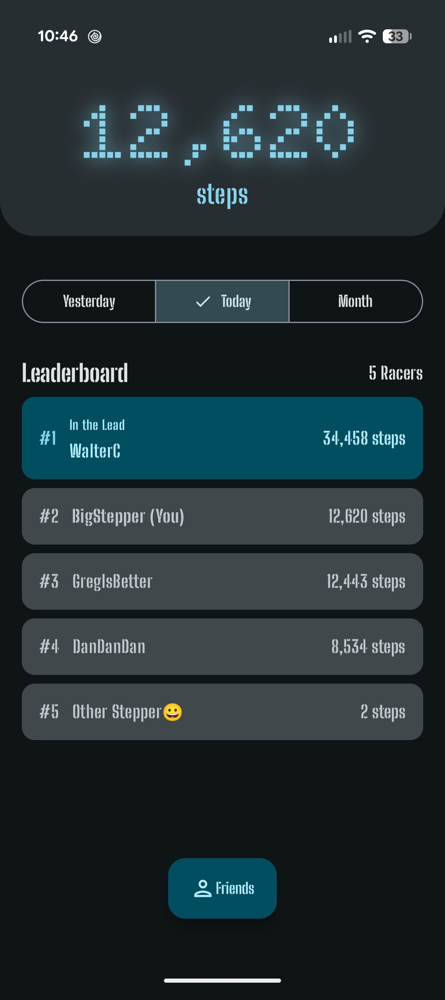

# Footrace
Compete in a global footrace with your friends!

Ever wanted to quickly compare your friends' steps in a quick and competitive manner but struggled to track the runs in a special app? Footrace is a lower-effort competitive step tracker!

## Functionality
Footrace uses Android's Health Connect API to fetch step data from your phone's health app, allowing anyone to immediately join the race! 

To join, simply enter a username and you are ready to invite others into your footrace. Once more people join, your leaderboard grows more competitive, with the lead being more desirable!

## Building
Footrace is built with Kotlin and Android Jetpack. To get started, clone the repository and enter with Android Studio for the easiest start.

Footrace relies on Google Firebase, so you will need to create a Firebase project with Firestore and Authentication enabled. Then you place your `google-services.json` into the `app` folder.
